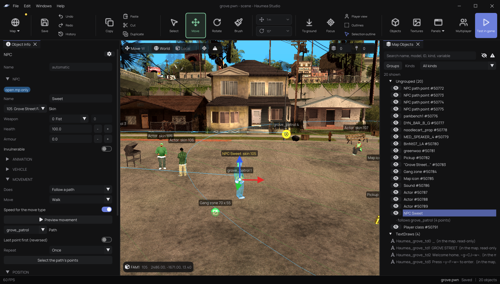
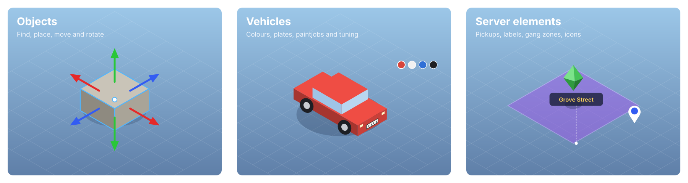
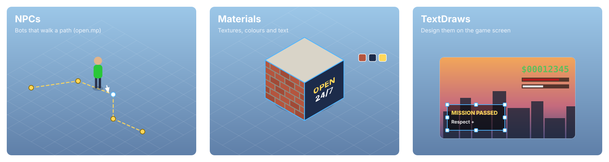
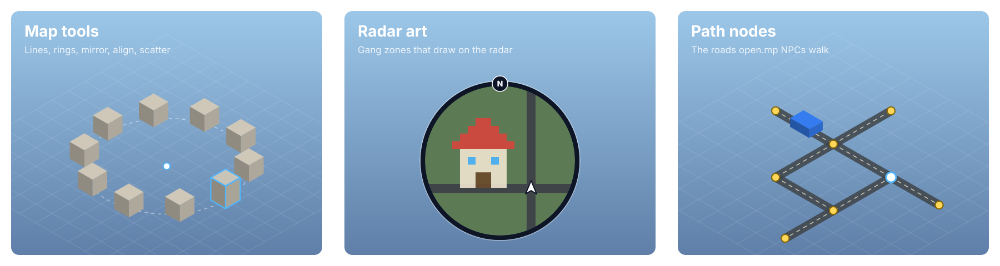
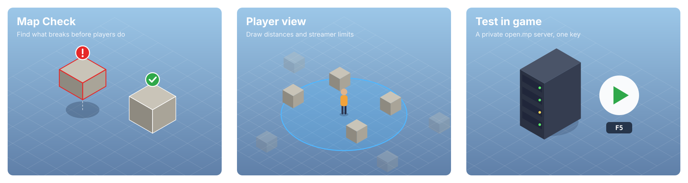
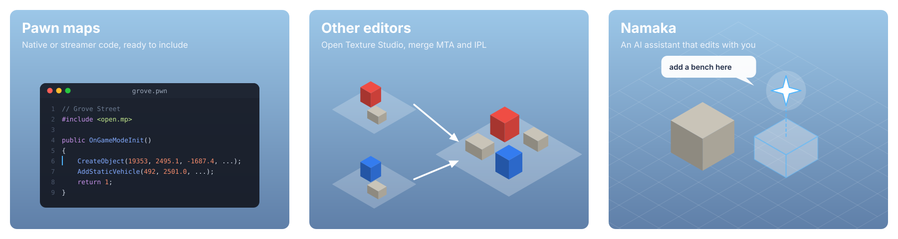
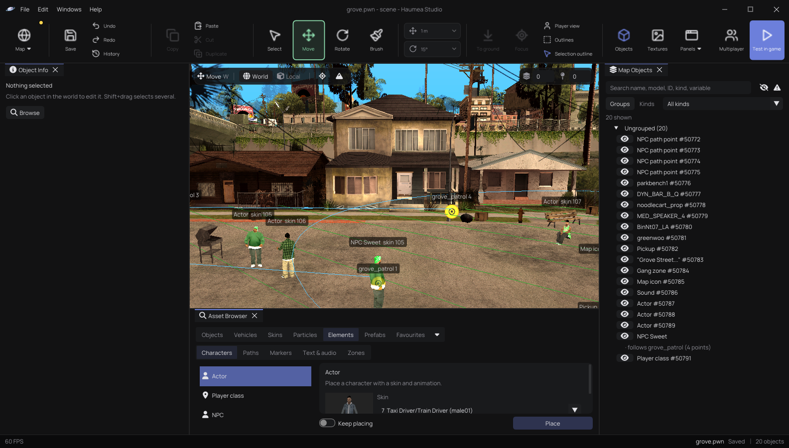
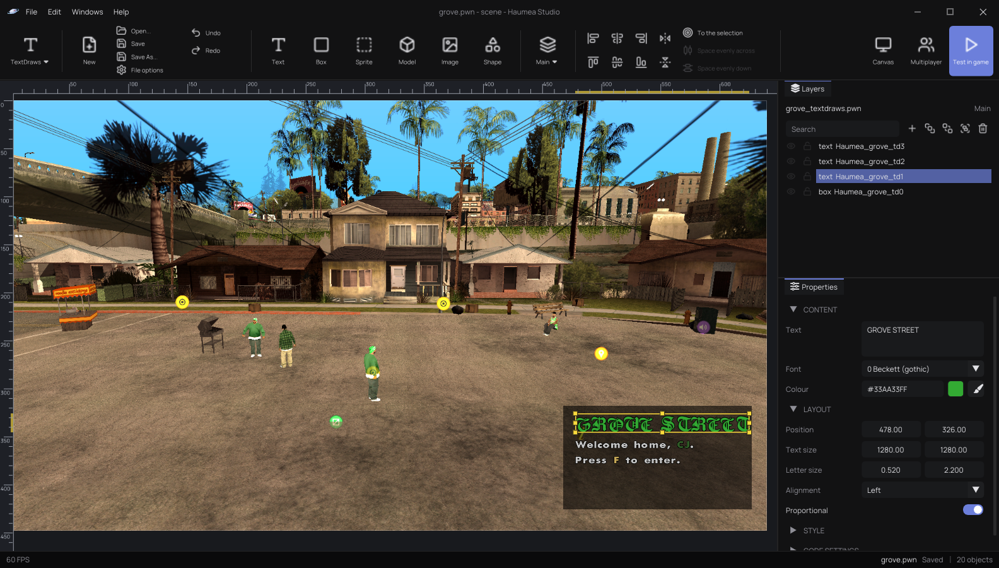
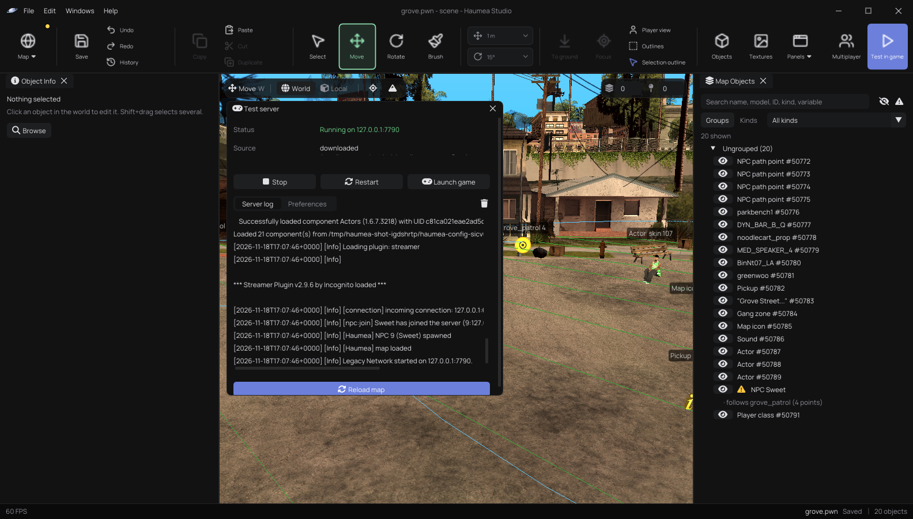

English | [Português (Brasil)](README.pt-BR.md)

<p align="center"></p>

<p align="center">
  <a href="https://github.com/Haumea-Team/Haumea-Studio/releases"></a>
  
  
  <a href="LICENSE"></a>
  <a href="https://discord.gg/YSxtANrsB4"></a>
</p>

<p align="center">
  <a href="#install"><b>Install</b></a> ·
  <a href="#quick-start"><b>Quick start</b></a> ·
  <a href="docs/USER_GUIDE.md"><b>User guide</b></a> ·
  <a href="docs/BUILDING.md"><b>Build from source</b></a> ·
  <a href="CONTRIBUTING.md"><b>Contribute</b></a>
</p>

# Haumea Studio

**The all-in-one editor for open.mp and SA-MP.** Build your server's world in GTA San Andreas:
objects, vehicles, NPCs, pickups, textdraws and more. Haumea Studio saves it all as a Pawn file
that your gamemode includes, checks it against the server's limits, and runs it on a test
server with one key.



New to Haumea Studio? Read the **[user guide](docs/USER_GUIDE.md)**.

## Features

### Build the map



- **Objects**: find GTA and SA-MP objects by name, ID or category, then place, move and rotate them, with undo.
- **Vehicles**: set colours, a number plate, a paintjob and tuning parts, and see them on the car.
- **Server elements**: pickups, 3D text labels, actors, player classes, gang zones, map icons, sounds and checkpoints.
- **Animations**: give actors and NPCs an animation and watch it in the editor.
- **Custom models** (0.3.DL): add your own models for SA-MP 0.3.DL and open.mp players.
- **Prefabs**: save a group of objects and place it again; a starter set is included.
- **Interiors**: go to any GTA interior and copy the Pawn code that takes a player there.



- **NPCs** (open.mp only): place bots that follow a path, walk the game's roads or play a recording.
- **Materials**: change an object's textures, colours and text, shown as players will see them.
- **TextDraws**: design textdraws on the game screen and save them in their own file.

### Shape it faster



- **Map tools**: copy objects in a line or a ring, mirror, align, scatter with a brush, and lay objects along a line.
- **Radar art**: turn your objects into gang zones that draw them on the radar (global, per-player or streamed; the last two are open.mp only).
- **Path nodes**: edit the roads that open.mp NPCs walk, saved to your server.

### Check and test



- **Map Check**: find what will break in game before players see it.
- **Player view**: see the map as a player sees it, with draw distances and streamer limits.
- **Test in game**: run the map on a private open.mp server with one key, then join it.

### Files and Namaka



- **Pawn maps**: save as native or streamer code that compiles with the open.mp and SA-MP 0.3.7 includes.
- **Code workspace**: edit generated Pawn or open scripts in a native editor with syntax highlighting, line numbers, undo/redo and find/replace. Manual edits save as a separate script, with recoverable drafts.
- **Other editors**: open Texture Studio maps, and merge MTA:SA and IPL maps into yours.
- **Namaka**: let an AI assistant look at and edit your map.
- **Autosave**: get back unsaved work after a crash.

### The editor

- **Editors**: switch between Map, TextDraws and Code from the top bar.
- **Workspaces**: a start screen with your servers and their maps.
- **Your own keys**: change every shortcut.
- **Panels**: dock them around the 3D view or let them float.
- **Safe for your game**: Haumea Studio never changes your game's files.

### In the app

<table>
  <tr>
    <td></td>
    <td></td>
    <td></td>
  </tr>
  <tr>
    <td align="center">Server elements on the SA-MP tab</td>
    <td align="center">The TextDraw designer</td>
    <td align="center">Test in game</td>
  </tr>
</table>

## Install

Download Haumea Studio from the [releases page](https://github.com/Haumea-Team/Haumea-Studio/releases).
You also need GTA San Andreas, and, to test maps, an open.mp or SA-MP server folder.

Download **one file** for your platform. Namaka is included in every platform download;
there is no separate companion ZIP to install.

| Platform | Install (recommended) | Portable |
| --- | --- | --- |
| Windows 64-bit | `Haumea-Studio-Windows-Setup.exe` | `Haumea-Studio-Windows-Portable.zip` |
| Linux x86_64 | `Haumea-Studio-Linux-Setup.run` | `haumea-linux-amd64.tar.gz` |
| macOS Apple Silicon | `Haumea-Studio-macOS-Apple-Silicon-Setup.dmg` | `Haumea-Studio-macOS-Apple-Silicon-Portable.zip` |

**Windows**: run Setup to add Haumea Studio to the Start menu. It installs for your account
and can be removed from Windows Settings. For portable use, extract the **entire** ZIP,
open the `Haumea Studio` folder and double-click `haumea.exe`. Keep its folders and DLLs beside it.

**Linux** (x86_64, glibc 2.38 or newer: Ubuntu 24.04, Debian 13, Fedora 39 or later):

```sh
sudo apt install libglfw3 curl python3 zenity  # Fedora: sudo dnf install glfw curl python3 zenity
                                            # Arch: sudo pacman -S glfw curl python zenity
sh Haumea-Studio-Linux-Setup.run
```

The installer needs Python 3.10+ and adds Haumea Studio to your applications menu. Run it
as your normal user. It installs in `$XDG_DATA_HOME/haumea-studio` (usually
`~/.local/share/haumea-studio`) and prints the uninstall command. For portable use, extract
`haumea-linux-amd64.tar.gz` into its own folder and run `./haumea` there.

**macOS**: open the DMG and drag **Haumea Studio** onto **Applications**, then open it
from Applications. The app includes GLFW. For the portable ZIP, install GLFW with
`brew install glfw`, extract the ZIP and run `./haumea` from
the `Haumea Studio` folder in Terminal. This build is for Apple Silicon. Namaka is
included: open **Windows → Namaka** to set it up with Python 3.10–3.14
(Python 3.14 supports offline setup).

The macOS downloads are unsigned. If macOS blocks the first launch, follow
[Apple's instructions for opening an app from an unidentified developer](https://support.apple.com/en-us/102445).

The Windows `.tar.gz` is for automatic updates; the symbols ZIP is for crash reports.
You do not need either to install. `SHA256SUMS` contains download checksums.

`kdialog` also works instead of `zenity`. Without either, type paths instead of browsing.
Your graphics driver must support OpenGL 3.3 (Mesa does).

**Test in game** on 64-bit Debian or Ubuntu also needs the 32-bit C library, once:

```sh
sudo dpkg --add-architecture i386 && sudo apt update
sudo apt install libc6:i386 libatomic1:i386
```

## Quick start

| | |
| :---: | --- |
| **1** | Start Haumea Studio and choose your GTA San Andreas folder and your server folder (the workspace). |
| **2** | Open the **Asset Browser** (<kbd>Ctrl</kbd>+<kbd>1</kbd>), pick an object, click **Place** and click in the world. |
| **3** | Press <kbd>F5</kbd> to test the map on a private open.mp server. |
| **4** | Press <kbd>Ctrl</kbd>+<kbd>S</kbd> to save it as a Pawn file. |

The [user guide](docs/USER_GUIDE.md) explains every feature. To build Haumea Studio or run its
tests, see [Building and testing](docs/BUILDING.md).

## Credits

- [JustMichael (ADRFranklin)](https://github.com/ADRFranklin): SA-MP model support.

## Lineage and license

Haumea Studio grew from euryopa, the map viewer in [librwgta](https://github.com/aap/librwgta), and is built on [librw](https://github.com/aap/librw), both by aap.

Licensed under the GNU GPL v2 or later; see [LICENSE](LICENSE) and [THIRD_PARTY_NOTICES.md](THIRD_PARTY_NOTICES.md).

To report a bug, suggest a feature, translate or contribute code, see [CONTRIBUTING.md](CONTRIBUTING.md).

<p align="center">
  <a href="https://discord.gg/YSxtANrsB4"><b>Haumea Discord</b></a> ·
  <a href="https://discord.gg/samp"><b>open.mp Discord</b></a>
</p>
