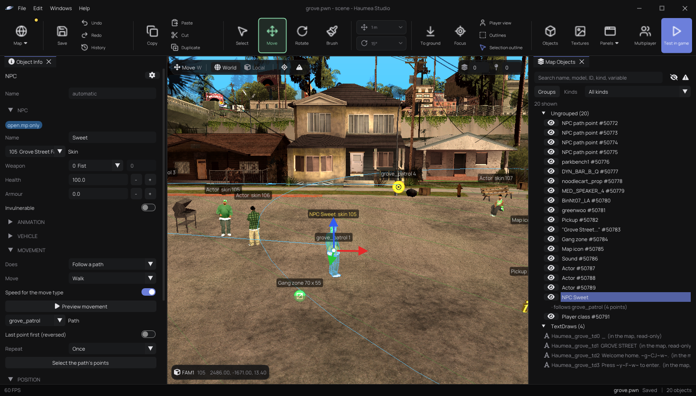
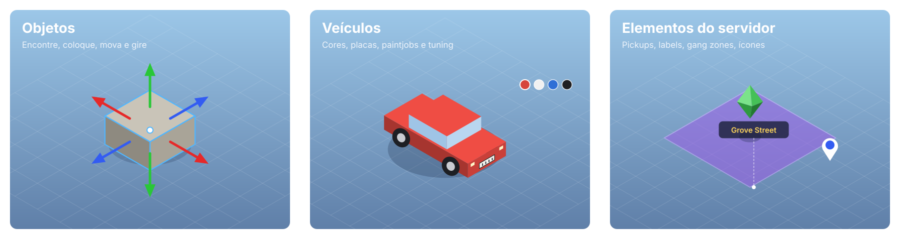
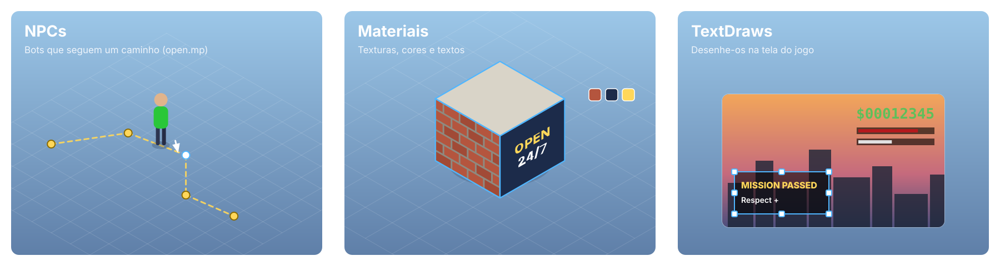
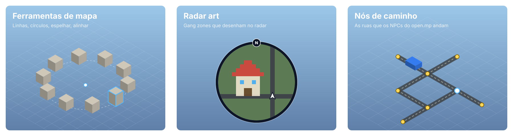
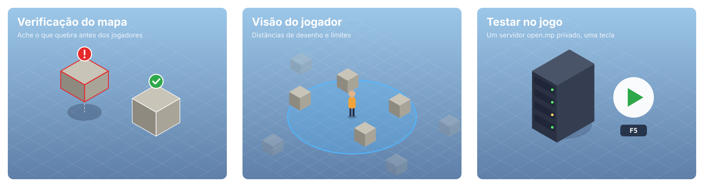
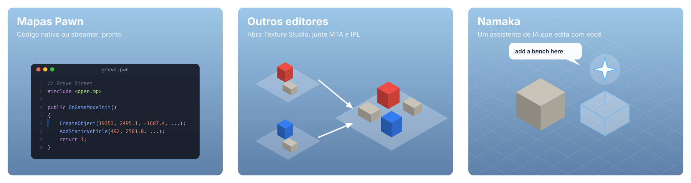
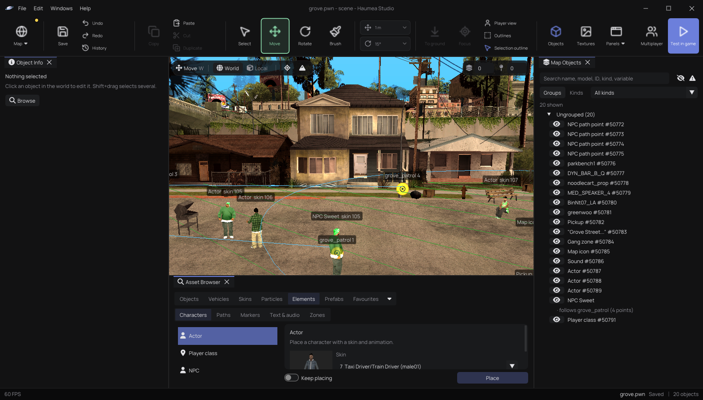
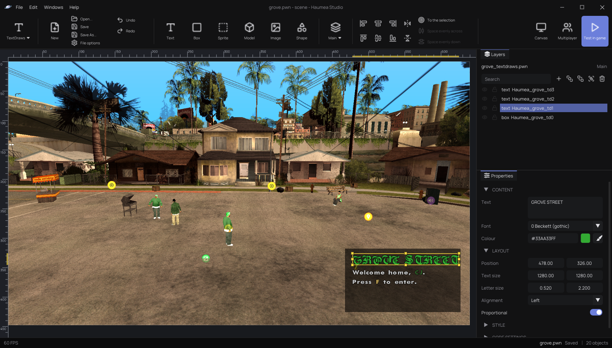
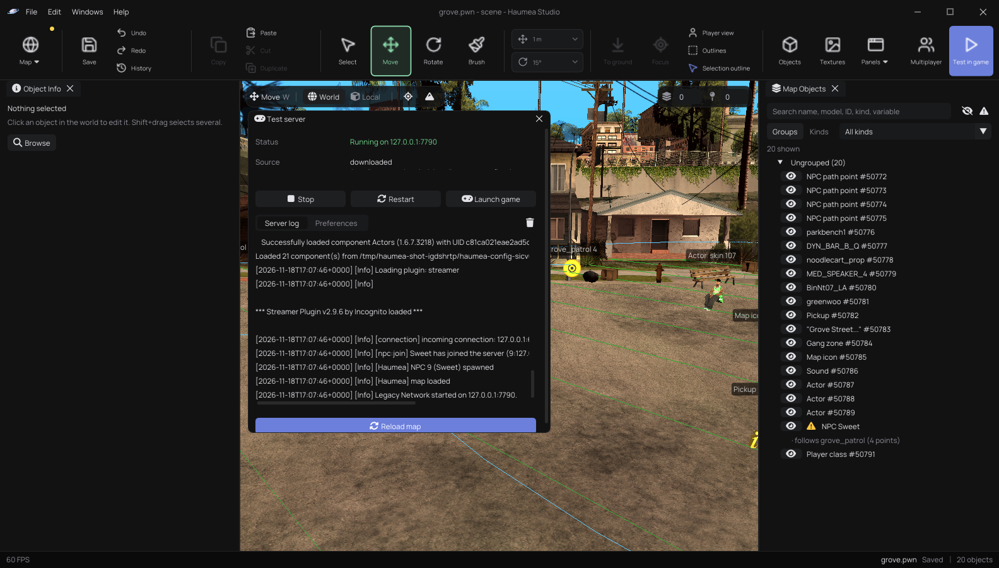

[English](README.md) | Português (Brasil)

<p align="center"></p>

<p align="center">
  <a href="https://github.com/Haumea-Team/Haumea-Studio/releases"></a>
  
  
  <a href="LICENSE"></a>
  <a href="https://discord.gg/YSxtANrsB4"></a>
</p>

<p align="center">
  <a href="#instalação"><b>Instalação</b></a> ·
  <a href="#primeiros-passos"><b>Primeiros passos</b></a> ·
  <a href="docs/USER_GUIDE.pt-BR.md"><b>Guia do usuário</b></a> ·
  <a href="docs/BUILDING.md"><b>Compilar</b></a> ·
  <a href="CONTRIBUTING.md"><b>Contribuir</b></a>
</p>

# Haumea Studio

**O editor completo para open.mp e SA-MP.** Monte o mundo do seu servidor no GTA San Andreas:
objetos, veículos, NPCs, pickups, textdraws e mais. O Haumea Studio salva tudo num arquivo Pawn
que o seu gamemode inclui, verifica o mapa contra os limites do servidor e o roda num servidor
de teste com uma tecla.



Começando com o Haumea Studio? Leia o **[guia do usuário](docs/USER_GUIDE.pt-BR.md)**.

## Recursos

### Monte o mapa



- **Objetos**: encontre objetos do GTA e do SA-MP por nome, ID ou categoria, depois coloque, mova e gire, com desfazer.
- **Veículos**: defina cores, placa, paintjob e peças de tuning, e veja tudo no carro.
- **Elementos do servidor**: pickups, 3D text labels, atores, classes de jogador, gang zones, map icons, sons e checkpoints.
- **Animações**: dê uma animação a atores e NPCs e veja-a no editor.
- **Modelos personalizados** (0.3.DL): adicione seus próprios modelos para jogadores do open.mp e do SA-MP 0.3.DL.
- **Prefabs**: salve um grupo de objetos e coloque-o de novo; um conjunto inicial vem incluído.
- **Interiores**: vá a qualquer interior do GTA e copie o código Pawn que leva um jogador até lá.



- **NPCs** (só open.mp): coloque bots que seguem um caminho, andam pelas ruas do jogo ou tocam uma gravação.
- **Materiais**: mude as texturas, cores e textos de um objeto, mostrados como os jogadores vão ver.
- **TextDraws**: desenhe textdraws na tela do jogo e salve-os num arquivo próprio.

### Monte mais rápido



- **Ferramentas de mapa**: copie objetos em linha ou em círculo, espelhe, alinhe, espalhe com um pincel e distribua objetos ao longo de uma linha.
- **Radar art**: transforme seus objetos em gang zones que os desenham no radar (globais, por jogador ou streamed; as duas últimas só no open.mp).
- **Nós de caminho**: edite as ruas por onde os NPCs do open.mp andam, salvas no seu servidor.

### Verifique e teste



- **Verificação do mapa**: encontre o que vai quebrar no jogo antes que os jogadores vejam.
- **Visão do jogador**: veja o mapa como um jogador vê, com distâncias de desenho e limites do streamer.
- **Testar no jogo**: rode o mapa num servidor open.mp privado com uma tecla e entre nele.

### Arquivos e Namaka



- **Mapas Pawn**: salve como código nativo ou streamer que compila com os includes do open.mp e do SA-MP 0.3.7.
- **Código**: edite o Pawn gerado ou abra scripts num editor nativo com cores, números de linha, desfazer/refazer e localizar/substituir. Edições manuais são salvas em um script separado, com recuperação de rascunhos.
- **Outros editores**: abra mapas do Texture Studio e mescle mapas do MTA:SA e IPL ao seu.
- **Namaka**: deixe um assistente de IA ver e editar o seu mapa.
- **Autosave**: recupere o trabalho não salvo depois de um travamento.

### O editor

- **Editores**: alterne entre Mapa, TextDraws e Código pela barra superior.
- **Workspaces**: uma tela inicial com seus servidores e os mapas deles.
- **Suas próprias teclas**: mude todos os atalhos.
- **Painéis**: encaixe-os em volta da vista 3D ou deixe-os flutuando.
- **Seguro para o seu jogo**: o Haumea Studio nunca altera os arquivos do seu jogo.

### No aplicativo

<table>
  <tr>
    <td></td>
    <td></td>
    <td></td>
  </tr>
  <tr>
    <td align="center">Elementos do servidor na aba SA-MP</td>
    <td align="center">O editor de TextDraws</td>
    <td align="center">Testar no jogo</td>
  </tr>
</table>

## Instalação

Baixe o Haumea Studio na [página de releases](https://github.com/Haumea-Team/Haumea-Studio/releases).
Você também precisa do GTA San Andreas e, para testar mapas, de uma pasta de servidor open.mp ou SA-MP.

Baixe **um arquivo** para sua plataforma. Os downloads de todas as plataformas já incluem o
Namaka; não é preciso baixar um ZIP separado do assistente.

| Plataforma | Instalação (recomendada) | Portátil |
| --- | --- | --- |
| Windows 64 bits | `Haumea-Studio-Windows-Setup.exe` | `Haumea-Studio-Windows-Portable.zip` |
| Linux x86_64 | `Haumea-Studio-Linux-Setup.run` | `haumea-linux-amd64.tar.gz` |
| macOS Apple Silicon | `Haumea-Studio-macOS-Apple-Silicon-Setup.dmg` | `Haumea-Studio-macOS-Apple-Silicon-Portable.zip` |

**Windows**: execute o Setup para adicionar o Haumea Studio ao menu Iniciar. A instalação
é feita para sua conta e pode ser removida nas Configurações do Windows. Para usar a versão
portátil, extraia o ZIP **inteiro**, abra a pasta `Haumea Studio` e execute `haumea.exe`.
Mantenha as pastas e DLLs ao lado dele.

**Linux** (x86_64, glibc 2.38 ou mais nova: Ubuntu 24.04, Debian 13, Fedora 39 ou posterior):

```sh
sudo apt install libglfw3 curl python3 zenity  # Fedora: sudo dnf install glfw curl python3 zenity
                                            # Arch: sudo pacman -S glfw curl python zenity
sh Haumea-Studio-Linux-Setup.run
```

O instalador precisa do Python 3.10+ e adiciona o Haumea Studio ao menu de aplicativos.
Execute-o com seu usuário normal. Ele instala em `$XDG_DATA_HOME/haumea-studio` (normalmente
`~/.local/share/haumea-studio`) e mostra o comando para desinstalar. Para usar a versão
portátil, extraia `haumea-linux-amd64.tar.gz` numa pasta própria e execute `./haumea` nela.

**macOS**: abra o DMG e arraste o **Haumea Studio** para **Aplicativos**, depois abra-o
em Aplicativos. O app já inclui o GLFW. Para usar o ZIP portátil, instale o GLFW com
`brew install glfw`, extraia o ZIP e execute `./haumea` na pasta `Haumea Studio`
pelo Terminal. Essa versão é para Apple Silicon. O Namaka já está incluído: abra
**Janelas → Namaka** para configurá-lo com Python 3.10 a 3.14
(o Python 3.14 permite a instalação sem internet).

Os downloads para macOS não são assinados. Se o macOS bloquear a primeira abertura, siga
[as instruções da Apple para abrir um app de um desenvolvedor não identificado](https://support.apple.com/en-us/102445).

O `.tar.gz` do Windows serve para atualizações automáticas, e o ZIP de símbolos, para
relatórios de falhas. Eles não são necessários para instalar. O arquivo `SHA256SUMS`
contém as somas de verificação dos downloads.

O `kdialog` também funciona no lugar do `zenity`. Sem nenhum dos dois, digite os caminhos em vez de procurar.
O driver de vídeo precisa suportar OpenGL 3.3 (o Mesa suporta).

**Testar no jogo** no Debian ou Ubuntu 64 bits também precisa da biblioteca C de 32 bits, uma vez:

```sh
sudo dpkg --add-architecture i386 && sudo apt update
sudo apt install libc6:i386 libatomic1:i386
```

## Primeiros passos

| | |
| :---: | --- |
| **1** | Abra o Haumea Studio e escolha a pasta do GTA San Andreas e a pasta do seu servidor (o workspace). |
| **2** | Abra o **Navegador de objetos** (<kbd>Ctrl</kbd>+<kbd>1</kbd>), escolha um objeto, clique em **Colocar** e clique no mundo. |
| **3** | Pressione <kbd>F5</kbd> para testar o mapa num servidor open.mp privado. |
| **4** | Pressione <kbd>Ctrl</kbd>+<kbd>S</kbd> para salvá-lo como arquivo Pawn. |

O [guia do usuário](docs/USER_GUIDE.pt-BR.md) explica cada recurso. Para compilar o Haumea Studio
ou rodar os testes dele, veja [Building and testing](docs/BUILDING.md) (em inglês).

## Créditos

- [JustMichael (ADRFranklin)](https://github.com/ADRFranklin): suporte a modelos do SA-MP.

## Origem e licença

O Haumea Studio nasceu do euryopa, o visualizador de mapas do [librwgta](https://github.com/aap/librwgta), e é construído sobre o [librw](https://github.com/aap/librw), ambos do aap.

Licenciado sob a GNU GPL v2 ou posterior; veja [LICENSE](LICENSE) e [THIRD_PARTY_NOTICES.md](THIRD_PARTY_NOTICES.md).

Para relatar um bug, sugerir um recurso, traduzir ou contribuir com código, veja [CONTRIBUTING.md](CONTRIBUTING.md) (em inglês).

<p align="center">
  <a href="https://discord.gg/YSxtANrsB4"><b>Discord do Haumea</b></a> ·
  <a href="https://discord.gg/samp"><b>Discord do open.mp</b></a>
</p>
